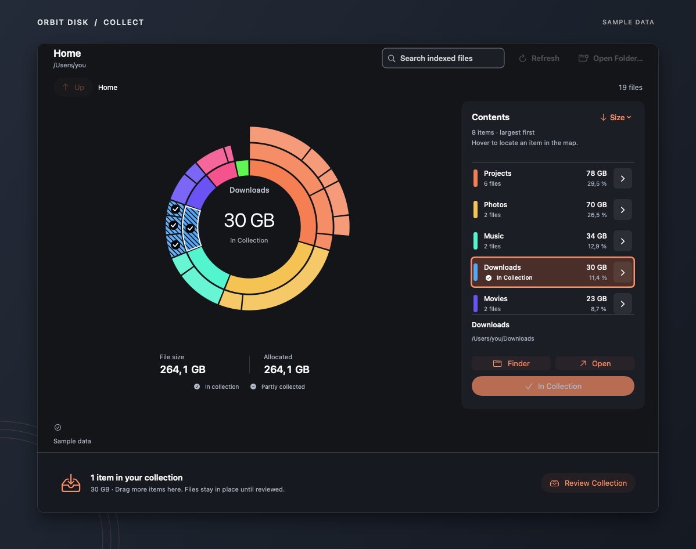

<p align="center">
  
</p>
<p align="center"><b>Orbit Disk</b></p>

<h1 align="center">Find what’s filling your Mac.</h1>

<p align="center">
  Orbit Disk maps your files and folders by size.<br>
  Open a folder on the map, or search the saved index by name.
</p>

<p align="center">
  <a href="https://github.com/JohnDeved/orbit-disk/releases/latest"></a>
</p>
<p align="center"><sub>macOS 14 or later · Apple silicon &amp; Intel</sub></p>

<br>

<p align="left">
  
</p>
<p><sub>Screenshots show sample data.</sub></p>

## Read the map

The outer rings show what’s inside each folder. Click a folder to open it; hover over a segment to find its row in Contents. Items too small to draw individually are still in the list.

## Review before removing

Drag files and folders from the map or list into the collection. They stay where they are until you review them and confirm **Move to Trash** or **Delete Permanently**.

<p align="right">
  
</p>

## Saved maps

You can browse folders as the first scan finds them. Orbit Disk saves the finished map locally and usually reopens it without another full scan. When macOS provides usable change history, the app updates changed folders in the background.

## Install

1. [Download the latest release](https://github.com/JohnDeved/orbit-disk/releases/latest), unzip it, and move **Orbit Disk.app** to Applications.
2. Open Orbit Disk and choose Home, a disk, or another folder to map.

The current release is ad-hoc signed and has not been notarized by Apple. If macOS blocks the first launch, approve it in **System Settings → Privacy & Security**. Later updates can be checked from the app. [More about installation and updates](docs/GUIDE.md#app-updates).

## Privacy and permissions

Scanning and search happen on your Mac. Orbit Disk contacts GitHub to check for updates; it does not upload your file names, paths, sizes, or contents.

macOS may restrict access to some folders. Full Disk Access is optional, and the app reports skipped items. Allocated space is a filesystem measurement; it is not a guarantee of how much space deletion will reclaim.

## Build

Install Swift 6.3 or later and Python 3, then run:

```sh
./build-app.sh
```

The script builds `../Orbit Disk.app` and resolves the pinned Sparkle dependency on the first run. The [guide](docs/GUIDE.md) covers shortcuts, tests, limitations, and release steps. See [technical notes](TECHNICAL-NOTES.md) for implementation details.

Screenshots are rendered from the app’s views with sample data. Run `./scripts/capture-marketing.sh` to refresh them locally; GitHub Actions refreshes them after app changes reach `main`.
