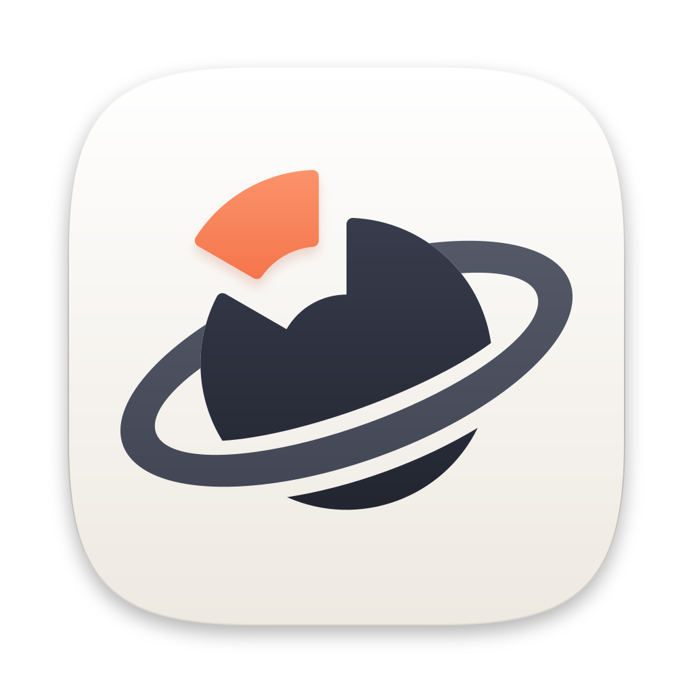
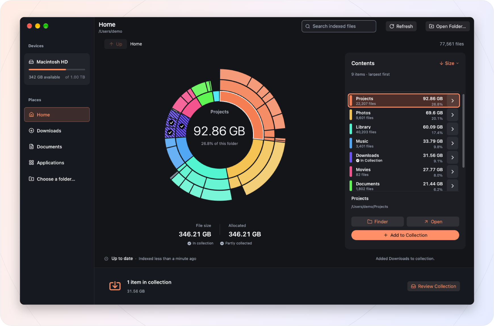
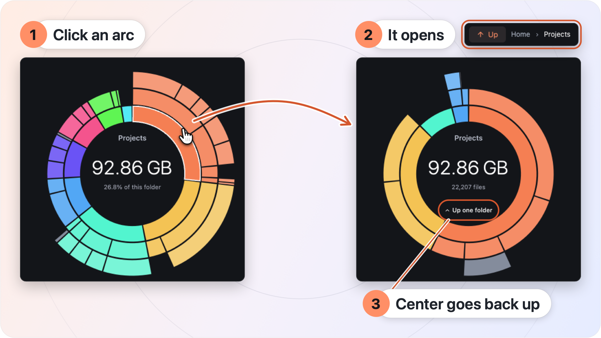
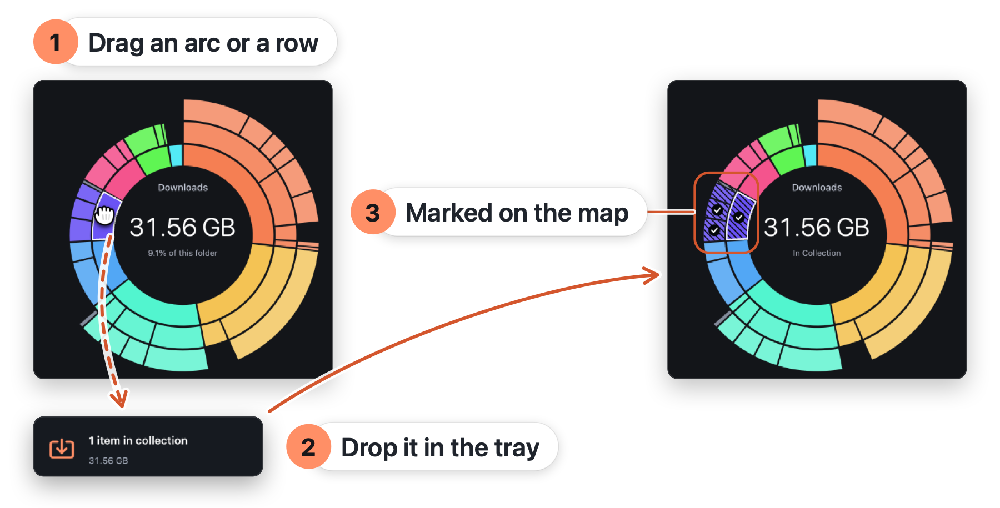
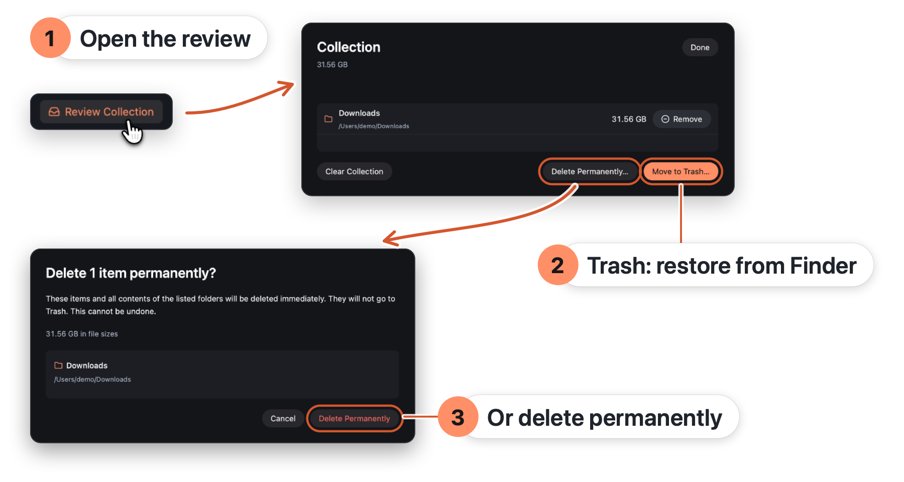
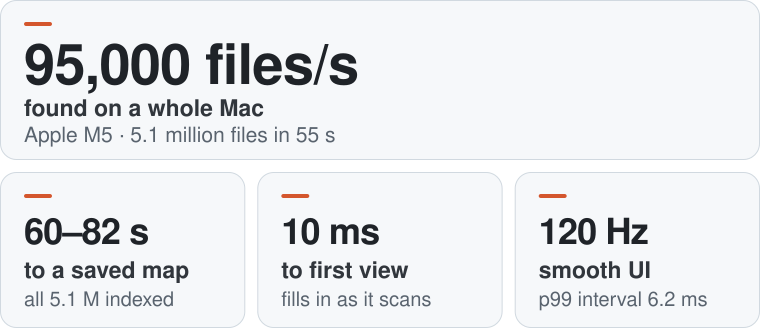

<p align="center">
  
</p>

<h1 align="center">Orbit Disk</h1>

<h3 align="center">Find what’s filling your Mac.</h3>

<p align="center">
  Orbit Disk scans your whole drive at about 95,000 files a second, and you can explore while it does. Each ring goes one folder deeper and each arc is sized by what’s inside, so the space hogs stand out. Collect what you don’t need; nothing is deleted until you confirm it in the review.
</p>

<p align="center">
  <a href="https://github.com/JohnDeved/orbit-disk/releases/latest/download/Orbit-Disk.dmg"></a>
</p>
<p align="center">
  <sub>Free and open source (MIT) · macOS&nbsp;14 or later · Apple&nbsp;silicon&nbsp;&amp;&nbsp;Intel · <a href="docs/GUIDE.md">Guide</a> · <a href="https://github.com/JohnDeved/orbit-disk/releases/latest">Release notes</a></sub><br>
  <sub>Runs locally · Trash by default · <a href="#ai-tools">AI tools</a> you connect can remove items too · Not notarized yet: <a href="#get-started">one-time approval</a></sub>
</p>

<br>

<p align="center">
<picture>
  <source media="(prefers-color-scheme: dark)" srcset="docs/screenshots/orbit-hero-dark.png">
  
</picture>
</p>
<p align="center"><sub>Screenshots show the app’s built-in sample data.</sub></p>

## How it works

Open Home, a disk or any folder. Then:

### Map: see where the space went

<p>
<picture>
  <source media="(prefers-color-scheme: dark)" srcset="docs/art/card-map-dark.png">
  
</picture>
</p>

1. **Click an arc** to open that folder.
2. **It opens**, and the breadcrumb shows where you are.
3. **Click the center** to go back up.

Pointing at an arc shows a tooltip with its size and highlights its row in the Contents list; pointing at a row highlights its arc. Items too small to draw stay in the list.

### Collect: gather what you don’t need

<p>
<picture>
  <source media="(prefers-color-scheme: dark)" srcset="docs/art/card-collect-dark.png">
  
</picture>
</p>

1. **Drag an arc or a row.** Or select it and press ⌘K.
2. **Drop it in the tray.** It stays there while you keep exploring.
3. **It’s marked on the map** with stripes and a check, and the list says “In Collection”.

You can collect files while the first scan is still running.

### Review: nothing moves until you say so

<p>
<picture>
  <source media="(prefers-color-scheme: dark)" srcset="docs/art/card-review-dark.png">
  
</picture>
</p>

1. **Open the review** from the tray, then choose:
2. **Move to Trash.** It asks you to confirm (Return works), and you can restore the items from the Trash in Finder; Orbit Disk never empties it.
3. **Or Delete Permanently.** Its confirmation lists every full path and warns that folder contents go too. It has no Return shortcut and cannot be undone.

## Fast and native

<p>
<picture>
  <source media="(prefers-color-scheme: dark)" srcset="docs/art/perf-dark.svg">
  
</picture>
</p>

Measured by scanning a whole Mac (Apple M5, 16 GB, 500 GB SSD) twice: the 5.1 million files it could read without Full Disk Access were found in 53–55 seconds, and the map was indexed and saved after 60–82 seconds. You don’t have to wait for that: the scan engine’s first view is ready in about 10 ms, and the map fills in as the scan runs. The 120 Hz figure is from the 0.10.0 release measurements. Older Macs, external disks and a cold start are slower. Method and raw output: [whole-drive benchmark](docs/benchmarks/whole-drive.md).

The next time, the map is already there. Finished maps are saved in a local SQLite index and usually reopen without a full scan; when macOS provides usable change history (FSEvents), changed folders update in the background. Search reads the saved index by name.

Orbit Disk is written in Rust and draws on the GPU with [GPUI](https://gpui.rs), the UI framework from the Zed editor. Scanning reads each folder with one `getattrlistbulk` pass, in parallel where the kernel allows, and commits to the index as it goes.

<p align="center"><code>Rust</code> · <code>GPUI on Metal</code> · <code>SQLite index</code> · <code>FSEvents updates</code> · <code>MCP tools</code></p>

## Get started

1. [Download Orbit Disk](https://github.com/JohnDeved/orbit-disk/releases/latest/download/Orbit-Disk.dmg), open the disk image, and drag **Orbit Disk.app** to Applications. To verify it, download `SHA256SUMS` from the [release page](https://github.com/JohnDeved/orbit-disk/releases/latest) into the same folder and run `shasum -a 256 -c SHA256SUMS --ignore-missing`.
2. Open it. The app is ad-hoc signed and not yet notarized by Apple, so macOS may block the first launch. If it does, go to **System Settings → Privacy & Security** and click **Open Anyway**.
3. Choose a location to map. Full Disk Access is optional; without it, the app lists what it couldn’t read.

Updates arrive in the app. [Installation and updates](docs/GUIDE.md#app-updates)

## Privacy

Scanning and search happen on your Mac. Orbit Disk contacts GitHub to check for and download updates; it never uploads file names, paths, sizes or contents. If you connect an AI client, that client receives the metadata returned by the tools you let it call and handles it according to its own settings.

Sizes on the map are logical file sizes. Allocated space is measured separately and isn’t a promise of how much space deletion will free: APFS clones, snapshots and directory metadata all affect it.

## AI tools

Orbit Disk includes an MCP server and a JSON command-line client. AI clients can inspect maps, find large files, build a collection and remove collected items, all through the live app, including files found while mapping continues.

**Orbit Disk → AI Integration…** connects Codex in one click, copies the settings for any other MCP client, and installs the `orbitdisk` command to `~/.local/bin` (add it to your `PATH` if needed):

```sh
orbitdisk status
orbitdisk scan '{"path":"/Users/you/Downloads"}'
orbitdisk list '{"limit":20}'
```

The manual Codex registration is `codex mcp add orbit-disk -- '/Applications/Orbit Disk.app/Contents/MacOS/OrbitControl' mcp`.

The app listens only on a Unix socket owned by your user: no TCP listener, no API key, no bundled model. The socket is open while the app runs, so any process running as your user can reach it. To remove anything, an agent first prepares a plan, which opens the review in the app, and then needs a single-use, five-minute token tied to exactly that plan. The agent chooses Trash or permanent deletion. Orbit Disk tells agents to get your approval before removing, but it can’t enforce that, so use a client that asks you before it runs tools. [Setup, tools and removal behavior](docs/AI-INTEGRATION.md)

## Build from source

Requires [Rust](https://rustup.rs) (the toolchain pinned in `rust-toolchain.toml` installs automatically), [cargo-nextest](https://nexte.st) and Python 3.

```sh
./build-app.sh                         # builds ../Orbit Disk.app for this Mac's architecture
./build-app.sh --universal             # Apple silicon + Intel
./build-app.sh --output /tmp/Orbit.app # choose where the app goes
cargo nextest run --workspace          # run the tests
cargo run -p orbit-disk -- --fixture   # open the app on generated sample data
```

The build downloads the pinned, checksum-verified Sparkle framework on its first run. With full Xcode installed, `--release-mode` precompiles the Metal shaders; otherwise the app compiles them at launch. The [guide](docs/GUIDE.md) covers shortcuts, tests, limitations and release steps.

Everything specific to macOS lives in two platform crates (`orbit-platform-macos`, `orbit-shell-macos`). The engine, app state, map geometry and automation are portable and tested on Linux, ready for future Windows and Linux layers. See [the architecture notes](docs/rust-port/README.md) and the [technical notes](TECHNICAL-NOTES.md) for the invariants the engine preserves.

<details>
<summary>Workspace layout and README images</summary>

| Crate | Role |
|---|---|
| `apps/orbit-disk` | The app: lifecycle, settings, shell, menus |
| `apps/orbit-control` | The `orbitdisk` CLI and the stdio MCP server that forwards tool calls to the running app |
| `orbit-core` | Scan engine: discovery, live inventory, durable SQLite index, search, removal journal and recovery |
| `orbit-backend` | The production engine behind the app state: mapping sessions, saved maps, change monitors, removal |
| `orbit-app-state` | UI-agnostic state machine: sessions, folders, collection, search, hover relations |
| `orbit-sunburst` | Sunburst layout, color ordinals and analytic hit-testing; pure math |
| `orbit-ui` | GPUI views |
| `orbit-automation` | Automation protocol, MCP tool catalog, Unix-socket transport, Codex installer |
| `orbit-platform` | The OS boundary: shared types and the traits every platform layer implements |
| `orbit-platform-macos` | `getattrlistbulk`, FSEvents, firmlinks, `clonefile`, Trash; the only engine crate that uses Apple APIs |
| `orbit-shell-macos` | Sparkle updater, reduce motion, relaunch, legacy settings import |
| `orbit-platform-generic` | Portable fallback (`readdir` + `fstatat`, no change history); runs the core tests on Linux CI |
| `orbit-native` | Selects the platform layer for the build target |
| `orbit-bench` | Criterion micro-benchmarks and probe binaries |

The hero and feature cards are real app windows in sample-data states (`--marketing-state`), composed by `scripts/marketing/{Hero,Cards}.swift`. Run `./scripts/capture-marketing.sh` to refresh them locally; GitHub Actions refreshes them from the released commit after each release.

</details>

## License

[MIT](LICENSE)
