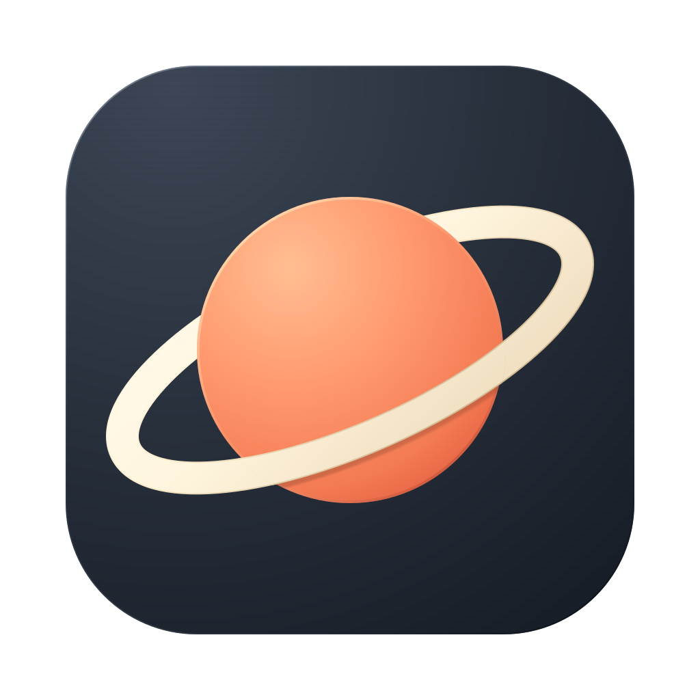
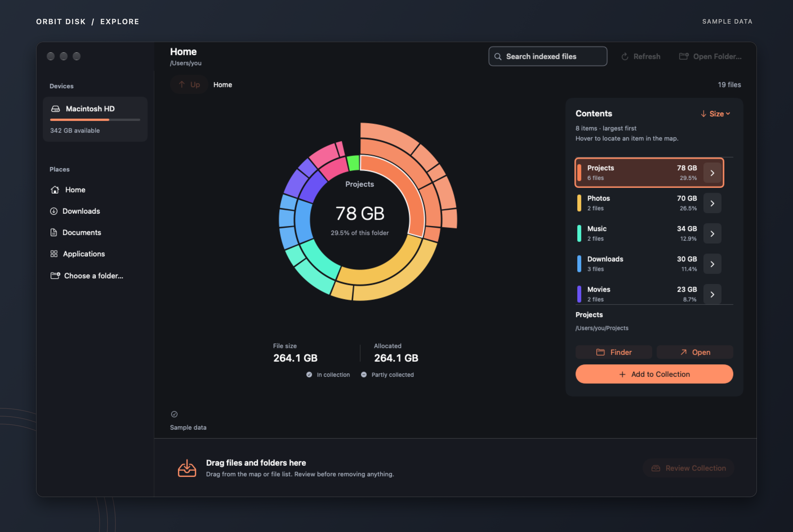
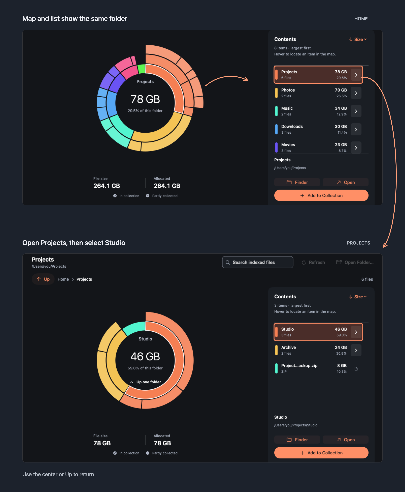
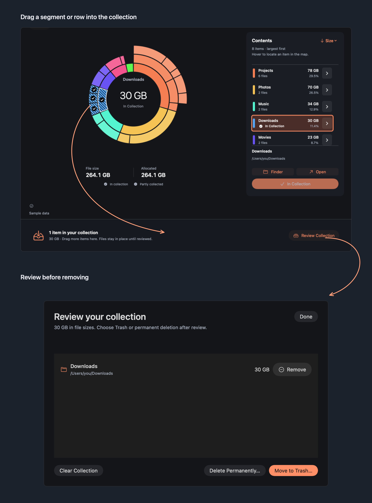

<p align="center">
  
</p>
<p align="center"><b>Orbit Disk</b></p>

<h1 align="center">Find what’s filling your Mac.</h1>

<p align="center">
  A visual map of your Mac, organized by file size.<br>
  Explore a folder, follow the larger files, and collect what you want to review.
</p>

<p align="center">
  <a href="https://github.com/JohnDeved/orbit-disk/releases/latest"></a>
</p>
<p align="center"><sub>macOS 14 or later · Apple silicon &amp; Intel &nbsp; | &nbsp; <a href="docs/GUIDE.md">Read the guide</a></sub></p>

<br>

<p align="center">
  
</p>
<p align="center"><sub>App views throughout this page use sample data.</sub></p>

## Follow the space

Choose Home, a disk, or another folder. Each ring shows another level inside it, and larger segments represent larger items. Hover over the map to find the matching row in Contents; hover over a row to find it on the map.

<p><b>Home → Projects → select Studio</b></p>

<p align="center">
  
</p>

Click a folder segment or its row arrow to open it. Click the center of the map to go back up. Items too small to draw individually are still available in the list.

## Collect, then review

Drag a segment or a list row into the collection tray. Collected items are marked on both the map and the list, so you can keep exploring without losing track of them.

<p><b>Map or list → collection tray → review</b></p>

<p align="center">
  
</p>

Files stay where they are until you review the collection and confirm **Move to Trash** or **Delete Permanently**. Permanent deletion has its own confirmation and cannot be undone.

## Your map is ready when you return

Start browsing while the first scan is still finding files. Orbit Disk saves completed maps on your Mac and usually reopens them without another full scan. When macOS provides usable change history, changed folders update in the background. Search reads the saved index by name.

## Get started

1. [Download the latest release](https://github.com/JohnDeved/orbit-disk/releases/latest), unzip it, and move **Orbit Disk.app** to Applications.
2. Open Orbit Disk and choose a location to map.

The app is ad-hoc signed and has not been notarized by Apple. If macOS blocks the first launch, approve it in **System Settings → Privacy & Security**. [Installation and updates](docs/GUIDE.md#app-updates)

## Privacy and permissions

Scanning and search happen on your Mac. Orbit Disk contacts GitHub to check for updates; it does not upload your file names, paths, sizes, or contents.

macOS may restrict access to some folders. Full Disk Access is optional, and the app reports skipped items. Allocated space is a filesystem measurement; it is not a guarantee of how much space deletion will reclaim.

## Build from source

Install Swift 6.3 or later and Python 3, then run:

```sh
./build-app.sh
```

The script builds `../Orbit Disk.app` and resolves the pinned Sparkle dependency on the first run. The [guide](docs/GUIDE.md) covers shortcuts, tests, limitations, and release steps. See [technical notes](TECHNICAL-NOTES.md) for implementation details.

The screenshots and flow illustrations use sample data rendered from the app’s views. Run `./scripts/capture-marketing.sh` to refresh them locally; GitHub Actions refreshes them after app changes reach `main`.
